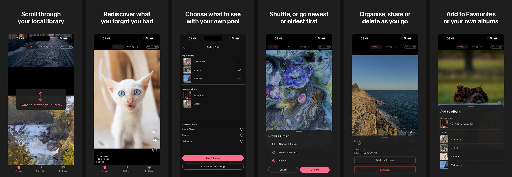

# WakeTok

**Wake what you saved.**

A local-first vertical scrolling app for rediscovering your own photo and video library.

Local-first. No account. Nothing uploaded to WakeTok.



[Available on the App Store](https://apps.apple.com/app/waketok/id6797156391)

WakeTok is an iPhone app for browsing your own Photos library full screen,
one item at a time, by swiping up and down. You choose what to browse and how
it is ordered: use the built-in All, Photos or Videos sources, or combine
albums into a Pool of your own.

Photo libraries keep growing, while older items are rarely seen again.

Built with Flutter and Swift, with PhotoKit and AVFoundation behind typed
Pigeon contracts.

---

## What WakeTok does

- Swipe up and down through photos, videos and Live Photos full screen,
  across your whole library or only the sources you choose.
- Build and save Pools from your own albums and supported system albums,
  then browse them together. A Pool remembers its sources, not individual
  items.
- Choose Shuffle, Newest or Oldest. When one pass finishes, Shuffle creates a
  new order; Newest and Oldest start again from the beginning.
- Swipe left to add an item to the WakeTok album in Photos as a bookmark for
  later.
- While browsing, add an item to or remove it from Favourites, add it to
  another album, move it to Recently Deleted, or share it through the system
  share sheet.
- Pinch to zoom photos, animated images and a Live Photo's still frame; tap or
  scrub through videos; and long-press to replay a Live Photo.
- See a relative date, an approximate calendar date, a Live Photo or Animated
  label where applicable, and file size when available.

---

## Tech stack

| Layer | Choice |
|---|---|
| UI and state | Flutter, Dart and Riverpod |
| Native media | Swift, PhotoKit and AVFoundation |
| Video surface | Flutter `UiKitView` with `AVPlayerLayer` |
| Typed platform contracts | Pigeon-generated Dart and Swift APIs |
| Local data | Drift on SQLite; SharedPreferences |
| Localisation | Flutter `gen_l10n` with English and Simplified Chinese resources |
| Verification | Flutter unit, widget and architecture tests; Swift XCTest in `RunnerTests` |

---

## Engineering highlights

### Native media behind a typed boundary

Dart owns product and session rules; Swift owns PhotoKit and AVFoundation I/O.
Pigeon generates typed APIs on both sides and maps native failures into the
Dart error model. The native player is app-scoped rather than owned by a
Flutter route, while the Platform View attaches the current video surface.

### Platform View selected on device

Both Platform View and a Texture alternative were profiled on an iPhone 13
Pro. The Texture path did not improve scrolling and produced worse recorded
hitch results, so I kept `UiKitView` with `AVPlayerLayer` as the production
video surface.

### Cancellable iCloud loading

WakeTok uses a local preview first when one is available. It waits until the
current item has settled before starting an iCloud-backed request for
higher-quality media, and cancels in-flight work when the user leaves. Loading
remains visible while the user can continue browsing.

This policy came from a measured failure. Before WakeTok cancelled work when
the user left an item, an instrumented, roughly 75-second skip-heavy Videos run
on an iPhone 13 Pro with iCloud Photos' Optimize iPhone Storage enabled
increased used storage by about 7 GB, although only the first and last iCloud
videos were allowed to play. After these loading changes, separate
no-Instruments checks recorded growth of 0.18 GB for Videos and 0.02 GB for
All, both explainable by watched items. *(ADR-029, ADR-031)* The measurement
records are kept in the project's docs.

### Gesture arbitration

The browsing surface coordinates vertical paging, horizontal bookmark swipes,
pinch to zoom, video taps and scrubbing, and Live Photo long presses. Explicit
rules decide which gesture wins when several could apply to the same
interaction.

### Stable source and session rules

A Pool remembers an ordered combination of sources. Opening it resolves the
current items, counts each Photos asset once even when several sources include
it, and builds a stable browsing order. That order does not silently change in
the middle of a session; a new session resolves the sources again.

### Enforced architecture boundaries

The composition root wires feature code to domain interfaces, local
persistence and platform gateways. Architecture tests enforce the dependency
boundaries: feature code cannot import persistence or platform
implementations, domain code remains independent of Flutter and Riverpod, and
generated Pigeon APIs stay behind platform gateways.

---

## Architecture

| Layer | Path | Role |
|---|---|---|
| Composition | `lib/app/` | Binds domain interfaces to their implementations and provides them to features |
| Features | `lib/features/` | Widgets and presentation |
| Domain | `lib/domain/` | Models, sessions and interfaces |
| Data | `lib/data/` | Saved Pools in Drift on SQLite; preferences in SharedPreferences |
| Platform | `lib/platform/` | Dart gateways to native media services through Pigeon |
| Native media | `ios/Runner/Platform/` | Swift services on PhotoKit and AVFoundation |

Features use domain interfaces provided by the composition root; the data and
platform layers implement them.

---

## Platform and Photos access

WakeTok v1 supports iPhone and has a minimum deployment target of iOS 18.0.
The [`android/`](android/) directory contains a Flutter-generated scaffold;
there is no supported Android build.

With Limited Photos access, WakeTok shows only the items you select. Full
access is required to create or open Pools, add items to or remove them from
Favourites, and choose another album. The fixed WakeTok album bookmark remains
available with Limited access.

The current iPhone version supports the complete workflow described above.

---

## Roadmap

- WakeTok is under active development; version 1.0.0 is available on the App Store.
- This repository publishes source for review under **all rights reserved**; it is not an open-source release.
- A focused **v1.0.1** update is planned: Third-party licences page, iPhone SE permission-button layout and single-item vertical-feed rubber-band scrolling.
- **V2 for iOS** follows as an ordered candidate set; its scope may change.
- An **Android port of V2 as shipped on iOS** is planned after V2.
- **V2.1 for iOS** follows with location information and Hide as candidates.
- **V3 and later** items are an unsequenced candidate backlog, not commitments.
- See [`docs/STATE.md`](docs/STATE.md) for capability-level status. Last reviewed: 2026-10-09; no release date or schedule promise is implied.

---

## Build and run

The commands below were verified with Flutter 3.41.9 stable, Dart 3.11.5,
Xcode 26.3 and CocoaPods 1.16.2. The minimum deployment target is iOS 18.0.
Generated localisation, Pigeon and Drift sources are checked into the
repository.

```bash
flutter pub get
flutter build ios --simulator --debug
flutter test
```

The simulator build prepares the iOS workspace and installs Pods before the
standalone Swift test command. `flutter test` runs the Dart and Flutter unit,
widget and architecture tests. Swift `RunnerTests` run separately through
Xcode:

```bash
xcodebuild test \
  -workspace ios/Runner.xcworkspace \
  -scheme Runner \
  -destination 'platform=iOS Simulator,id=<simulator-udid>'
```

Run on an installed simulator:

```bash
flutter devices
flutter run -d <device-id>
```

Before running on a physical iPhone, open `ios/Runner.xcworkspace`, select your
own Development Team, and replace the repository's Bundle Identifier with a
unique value.

Regenerate checked-in sources only after changing their corresponding inputs:

```bash
flutter gen-l10n
dart run pigeon --input pigeon/waketok_platform_apis.dart
dart run build_runner build --delete-conflicting-outputs
```

The Debug app has been launched on an iPhone simulator. Release builds have
also been acceptance-tested on physical iPhone 13 Pro and iPhone 17 devices.

---

## Architecture decisions

The append-only [`docs/DECISIONS.md`](docs/DECISIONS.md) records the product
and architecture decisions behind the implementation, including media
ownership, source and session semantics, iCloud loading, gesture arbitration,
persistence and platform boundaries.

---

## Copyright

Source published for review. All rights reserved.

The WakeTok name and icon are not licensed for reuse.

Third-party components remain subject to their respective licences.

See [LICENSE](LICENSE).

## Contact

For questions or feedback, email
[dennygan.nz@gmail.com](mailto:dennygan.nz@gmail.com).
